# agro-platform

Plataforma full-stack para gestão dos cadastros do ecossistema agrícola — **Produtor**, **Propriedade** e **Laboratório** — com integrador de dados resiliente, motor financeiro extensível e consulta analítica de laboratórios. Projeto de portfólio, desenvolvido change a change com [OpenSpec](openspec/) e decisões registradas em [ADRs](docs/adr/README.md).

> **Demo:** <https://agro.gabrielriguiti.com.br> (leitura aberta; escrever exige a senha enviada em privado, [ADR-0021](docs/adr/0021-demo-publico-com-protecao-no-proxy-e-banco-dedicado.md)). API e Swagger UI: `/swagger-ui.html` em execução local.

## Stack

- **API:** Java 17, Spring Boot 3.3, Maven, PostgreSQL + Flyway, springdoc (OpenAPI 3), logs JSON, JUnit 5, Testcontainers e ArchUnit.
- **Web:** React + TypeScript (Vite), React Router, React Query e CSS próprio, sem biblioteca de componentes ([ADR-0017](docs/adr/0017-front-simples-com-vite-react-e-cliente-tipado.md)).
- **Monorepo:** pnpm + Turborepo ([ADR-0007](docs/adr/0007-monorepo-pnpm-turborepo-com-api-java.md)): `apps/api`, `apps/web` e `packages/api-client` (tipos gerados do OpenAPI).

## Como rodar

### Com Docker (um comando)

```bash
docker compose up --build                              # PostgreSQL, API e web
SPRING_PROFILES_ACTIVE=demo docker compose up --build  # o mesmo, com dados fictícios
```

Web em <http://localhost:8081> e Swagger UI em <http://localhost:8080/swagger-ui.html>. O PostgreSQL fica na porta 5433 do host (credenciais de desenvolvimento `agro`/`agro`). O profile `demo` envia ao pipeline um lote com laboratórios, propriedades, produtores e **um item inválido de propósito** (CPF com dígitos errados), que aparece na DLQ do monitor; rodar de novo não duplica nada. `docker compose down -v` apaga o banco.

### Sem Docker para a API

Pré-requisitos: JDK 17, Maven 3.9+, Node 20+, pnpm 10+ e Docker (PostgreSQL local e testes de integração).

```bash
pnpm install

# banco local (credenciais de desenvolvimento: agro/agro)
docker run -d --name agro-pg -e POSTGRES_USER=agro -e POSTGRES_PASSWORD=agro -e POSTGRES_DB=agro -p 5432:5432 postgres:16-alpine

# API em http://localhost:8080 (profile local = logs em texto)
cd apps/api && mvn spring-boot:run -Dspring-boot.run.profiles=local

# web em http://localhost:5173 (em outro terminal, a partir da raiz)
pnpm --filter @agro/api-client build   # gera os tipos do contrato
pnpm --filter web dev
```

Endereços da API: `/actuator/health`, `/v3/api-docs` e `/swagger-ui.html`. Configuração por variáveis de ambiente: `DB_URL`, `DB_USER`, `DB_PASSWORD`.

> Se a máquina tiver mais de um JDK, use o 17 (`JAVA_HOME`): o projeto compila com `release 17`.

## Verificação

```bash
pnpm verify      # API (testes unitários, ArchUnit e *IT com Testcontainers), web (typecheck, testes, build) e pacotes
pnpm docs:check  # links relativos da documentação
```

A API também funciona sem Node: `cd apps/api && mvn verify`. Testes `*Test` rodam no Surefire (sem Docker); testes `*IT` rodam no Failsafe e exigem Docker.

### Contrato OpenAPI e cliente do web

O contrato da API fica versionado em `packages/api-client/openapi.json`; `openapi-typescript` gera os tipos usados pelo web. Ao mudar a API, suba-a e rode `scripts/export-openapi.sh`: o `typecheck` do web quebra se ele usar algo que saiu do contrato.

## Arquitetura

Hexagonal com DDD pragmático ([ADR-0001](docs/adr/0001-arquitetura-hexagonal-com-ddd-pragmatico.md)), com fronteiras verificadas por ArchUnit no build ([ADR-0005](docs/adr/0005-fronteiras-de-arquitetura-verificadas-com-archunit.md)).

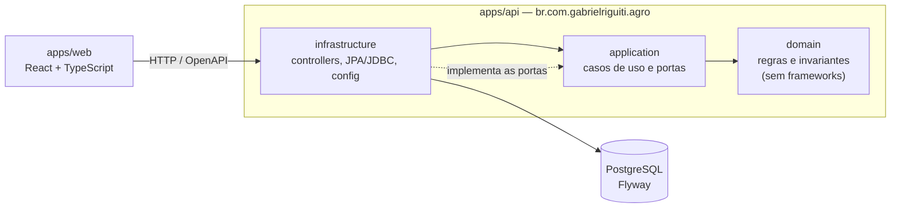

Regras (testadas em `ArchitectureTest`): `domain` só depende de Java padrão; `application` nunca depende de `infrastructure`; controllers não acessam a persistência; o motor financeiro não importa Spring.

## Motor financeiro

O valor é calculado por uma calculadora (Strategy) por natureza, em `application.financial`, sem Spring ([ADR-0010](docs/adr/0010-motor-financeiro-como-strategy-puro-com-taxas-configuraveis.md)). **As fórmulas são uma premissa**: o enunciado não as define e elas devem ser validadas com o negócio.

| Natureza | Fórmula | Padrões (BRL) |
|---|---|---|
| Produtor | `diasDeVigência × comissãoDiária + propriedades × comissãoPorPropriedade` | 120,00 por dia; 50,00 por propriedade |
| Propriedade | `taxaOperacional + taxaTerritorial` | 300,00; 150,00 |
| Laboratório | `taxaOperacional + produtores × taxaTerritorialPorProdutor` | 500,00; 25,00 por produtor |

Os dias de vigência são o intervalo entre `dataInicial` e `dataFinal` arredondado para cima (mínimo 1), e todo valor tem duas casas (`HALF_EVEN`).

**Exemplo:** produtor com 5 dias de vigência e 2 propriedades = 5 × 120,00 + 2 × 50,00 = **700,00**. Um laboratório com 4 produtores = 500,00 + 4 × 25,00 = **600,00**; uma propriedade = 300,00 + 150,00 = **450,00**.

```bash
curl localhost:8080/api/financial/producers/10     # também: /properties/{id} e /laboratories/{id}
# {"valor":700.00,"natureza":"PRODUCER","componentes":[{"nome":"dailyCommission","quantidade":5,"valorUnitario":120.00,"subtotal":600.00}, ...]}
```

As taxas mudam por configuração, sem recompilar (por exemplo, a variável `AGRO_FINANCIAL_PRODUCER_DAILY_COMMISSION=100.00`):

| Propriedade | Padrão |
|---|---|
| `agro.financial.producer.daily-commission` / `.property-commission` | 120.00 / 50.00 |
| `agro.financial.property.operational-fee` / `.territorial-fee` | 300.00 / 150.00 |
| `agro.financial.laboratory.operational-fee` / `.territorial-fee-per-producer` | 500.00 / 25.00 |

Para uma nova regra, implemente `FinancialCalculator` e declare-a como bean: o motor e as calculadoras existentes não mudam.

## Integração de dados

Parceiros (ERP, LIMS, órgãos de governo) enviam produtores, propriedades e laboratórios em lote ou de forma pontual. A API só **grava** (202) e um worker **processa** depois, com idempotência, retry e DLQ ([ADR-0011](docs/adr/0011-outbox-como-inbox-em-postgresql.md) a [0015](docs/adr/0015-estrategias-de-reconciliacao.md)). A tabela `outbox_message` no PostgreSQL é a fila durável; sem broker externo, e a porta `OutboxPort` mantém a escolha substituível.

```bash
curl -X POST localhost:8080/api/integration/batches -H 'Content-Type: application/json' -d '{
  "source": "erp-fazendas", "mergeStrategy": "MERGE",
  "items": [{ "type": "PRODUCER", "externalId": "P-9", "data": {
    "nome": "Maria", "inscricaoFiscal": "529.982.247-25", "endereco": "Linha 5, Sorriso/MT",
    "dataInicial": "2025-01-01T00:00:00Z", "dataFinal": "2025-12-31T23:59:59Z",
    "laboratorio": { "id": "LAB-1", "nome": "Lab Central", "inscricaoFiscal": "11.222.333/0001-81", "endereco": "Av. Brasil, 1" },
    "propriedades": [ { "id": "PR-1", "nome": "Fazenda Sol", "inscricaoFiscal": "390.533.447-05", "endereco": "BR-163, km 12" } ]
  } }]
}'
# 202 {"batchId":1,"accepted":1,"duplicates":0}
```

| Endpoint | Função |
|---|---|
| `POST /api/integration/batches` | ingere um lote (1 a 1000 itens) |
| `GET /api/integration/batches` e `/{id}` | lotes com contagens por status e estado (`EM_ANDAMENTO`, `CONCLUIDO`, `CONCLUIDO_COM_FALHAS`) |
| `GET /api/integration/messages?status=DEAD&batchId=` e `/{id}` | mensagens paginadas (DLQ com `status=DEAD`); o payload vem no detalhe |
| `POST /api/integration/messages/{id}/reprocess` e `/batches/{id}/reprocess` | reenfileira o que está em `DEAD` (409 fora dele) |
| `POST /api/integration/worker/run` | executa um ciclo do worker (só com `manual-run-enabled=true`; senão, 404) |

### Ingestão

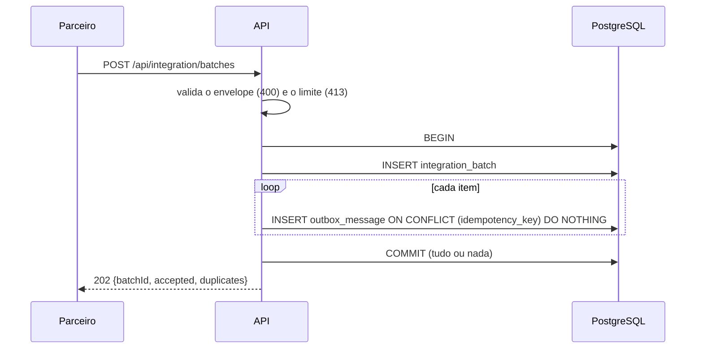

### Processamento

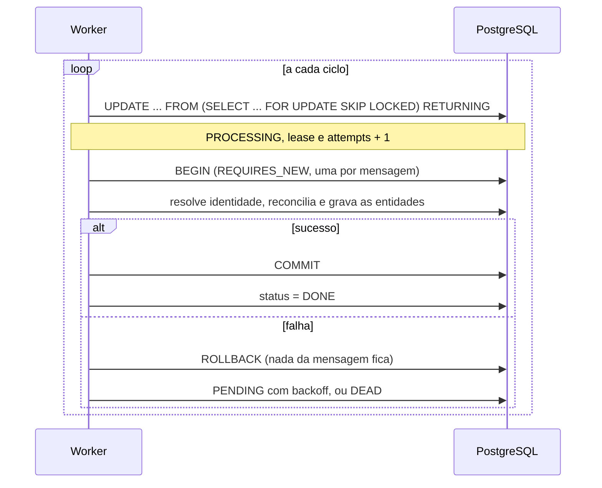

### Estados da mensagem

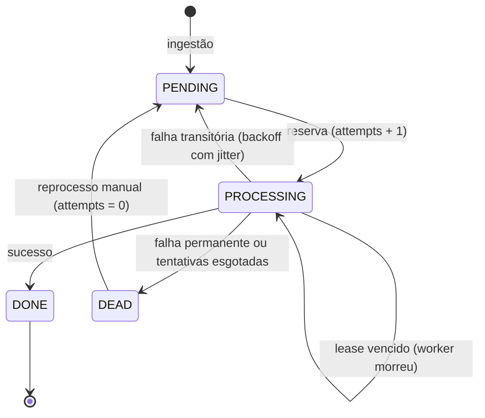

### Falhas, retry e reconciliação

- **Permanentes** (JSON malformado, campo ausente, CPF/CNPJ inválido, conflito de identidade) vão direto para `DEAD`. **Transitórias** (banco, corrida por CNPJ, desconhecidas) reagendam com `min(10 min, 5 s × 2^(n-1)) × (1 + 0,1 × r)` e vão para `DEAD` na 5ª tentativa.
- A identidade é resolvida por (`source`, `externalId`) e, na ausência, pela inscrição fiscal. Estratégias: `MERGE` (preserva o existente, preenche vazios), `OVERWRITE` (o recebido vence) e `KEEP_EXISTING` (ignora o recebido).
- Reenvio idêntico (mesmo `source`, tipo, id e payload, em qualquer ordem de campos) é `duplicates`; propriedades já vinculadas nunca são removidas por um reenvio.
- Cenários em Gherkin: [docs/bdd/](docs/bdd/README.md).

| Propriedade (`agro.integration.*`) | Padrão |
|---|---|
| `max-batch-size` / `max-attempts` / `worker-batch-size` | 1000 / 5 / 20 |
| `lease` / `poll-interval` | `PT2M` / `PT5S` |
| `backoff-base` / `backoff-max` / `backoff-jitter` | `PT5S` / `PT10M` / 0.1 |
| `scheduler-enabled` / `manual-run-enabled` | `true` / `false` |

## Análise de laboratórios

`GET /api/laboratories/analytics` compara laboratórios por produtores e valor financeiro, em **uma única consulta** com `GROUP BY`/`HAVING` ([ADR-0016](docs/adr/0016-consulta-analitica-em-sql-dinamico-como-leitura-separada.md)). Retorna `id`, `nome` em CAIXA ALTA, `totalProdutores` e `valorFinanceiroConsolidado` (motor financeiro aplicado ao `totalProdutores` do próprio resultado: 4 produtores = 600,00).

| Parâmetro | Obrigatório | Efeito |
|---|---|---|
| `qtdMinimaProdutores` | sim (≥ 1) | só laboratórios com ao menos essa quantidade de produtores **que atendem aos filtros** |
| `dataInicialInicio` / `dataInicialFim` | não | intervalo inclusivo sobre `dataInicial` do produtor (ISO-8601, instante UTC) |
| `dataFinalInicio` / `dataFinalFim` | não | intervalo inclusivo sobre `dataFinal` do produtor |
| `buscaTexto` | não | correspondência parcial, sem distinção de caixa, em `observacoes`; `%`, `_` e `\` são literais |

```bash
curl -G localhost:8080/api/laboratories/analytics \
  --data-urlencode 'qtdMinimaProdutores=2' \
  --data-urlencode 'dataInicialInicio=2025-01-01T00:00:00Z' \
  --data-urlencode 'dataInicialFim=2025-12-31T23:59:59Z' \
  --data-urlencode 'buscaTexto=integração'   # --data-urlencode codifica acentos e símbolos; sem isso o Tomcat responde 400
# [{"id":3,"nome":"LABORATÓRIO MODELO 1","totalProdutores":4,"valorFinanceiroConsolidado":600.00}, ...]
```

**Semântica do total (premissa a validar com o negócio):** os filtros incidem sobre os produtores. `totalProdutores` conta só os que atendem a todos os filtros (um laboratório com 4 produtores, 2 deles com o texto buscado, aparece com `totalProdutores` 2), `qtdMinimaProdutores` é aplicado a essa contagem e laboratórios sem produtor que atenda não aparecem. Parâmetro ausente, `qtdMinimaProdutores` < 1 ou intervalo invertido respondem 400.

**Ordenação:** `totalProdutores` decrescente; havendo filtro de `dataInicial`, a menor `dataInicial` entre os produtores considerados (crescente); desempate por `id`.

**Desempenho:** os índices `ix_producers_laboratory_id`, `ix_producers_data_inicial` e `ix_producers_data_final` (já em `V1__schema.sql`) apoiam a consulta. Plano real (PostgreSQL 16, 50 laboratórios, 200 mil produtores, `EXPLAIN (ANALYZE, COSTS OFF)` com filtro de um mês em `dataInicial` e texto):

```text
Sort  (Sort Key: count DESC, min(data_inicial), l.id)
  -> GroupAggregate (rows=32)
       -> Merge Join (rows=458)
            -> Sort -> Seq Scan on laboratories l (rows=50)
            -> Sort -> Bitmap Heap Scan on producers p (rows=458; Filter: observacoes ILIKE; removidas 2742)
                         -> Bitmap Index Scan on ix_producers_data_inicial (rows=3200)
```

Sem filtros o plano é um `Seq Scan` paralelo com `HashAggregate`, que é o certo quando todas as linhas contam. `ILIKE '%x%'` não usa índice b-tree: se o volume exigir, a evolução é `pg_trgm` com índice GIN em `observacoes`.

## Interface web

Telas em `apps/web`, que falam com a API só pelo contrato OpenAPI ([ADR-0017](docs/adr/0017-front-simples-com-vite-react-e-cliente-tipado.md)). Textos em português; os dados abaixo são fictícios.

| Tela | Rota | O que faz |
|---|---|---|
| Grid de produtores | `/produtores` | listagem paginada, edição e exclusão com confirmação |
| Formulário de produtor | `/produtores/novo`, `/produtores/:id/editar` | máscara e validação de CPF/CNPJ e do período, select de laboratório, multi-select de propriedades, erros 400/409 junto aos campos |
| Laboratórios | `/laboratorios`, `/laboratorios/novo`, `/laboratorios/:id/editar` | listagem, criação, edição e exclusão (CNPJ obrigatório; 409 se há produtores) |
| Propriedades | `/propriedades`, `/propriedades/novo`, `/propriedades/:id/editar` | listagem com situação (disponível ou vinculada), criação, edição e exclusão (desvincula do produtor) |
| Dashboard de laboratórios | `/analise` | filtros do endpoint analítico, tabela e gráfico de barras na ordem da API |
| Monitor de integração | `/integracao` | lotes (atualizados a cada 5 s), mensagens e DLQ, detalhe com erro e payload, reprocessamento e envio de lote de exemplo |

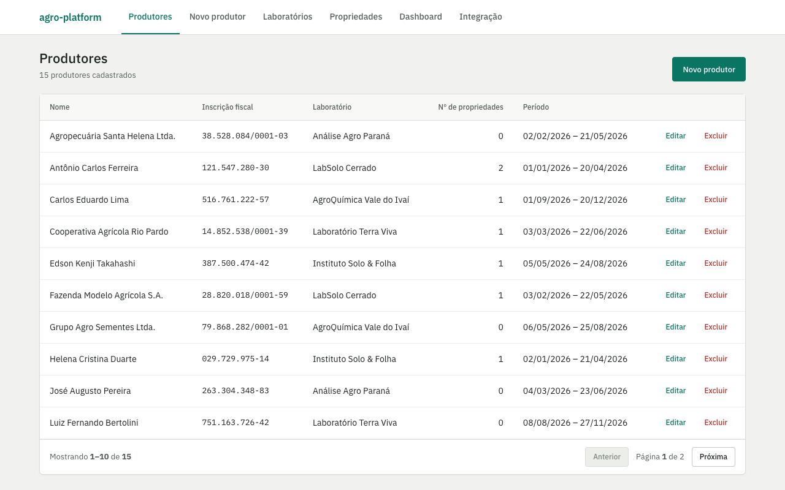

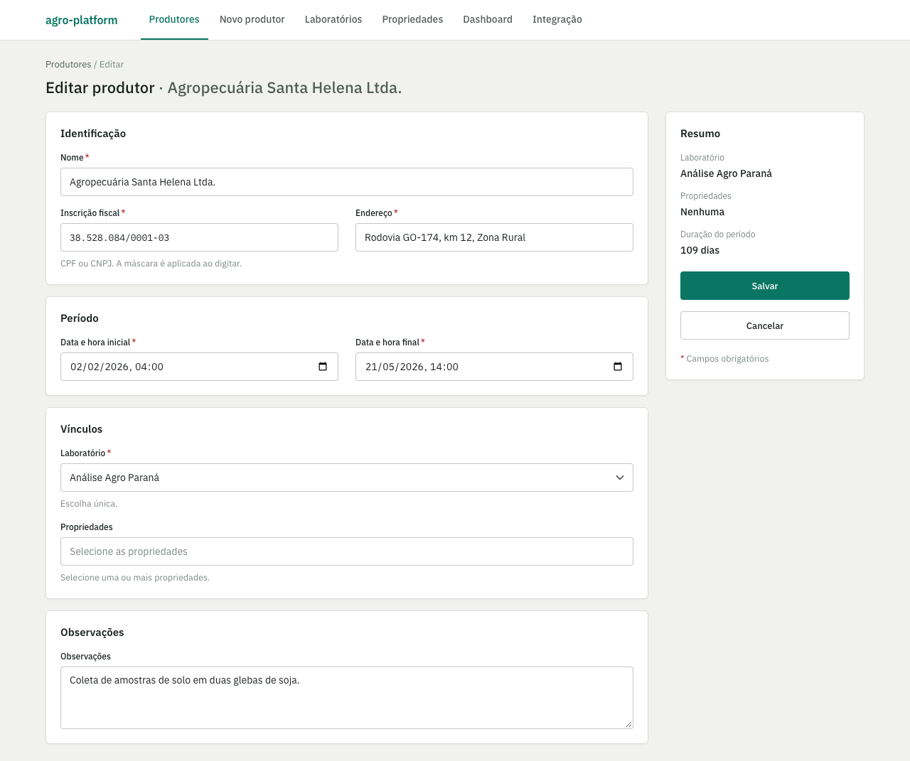

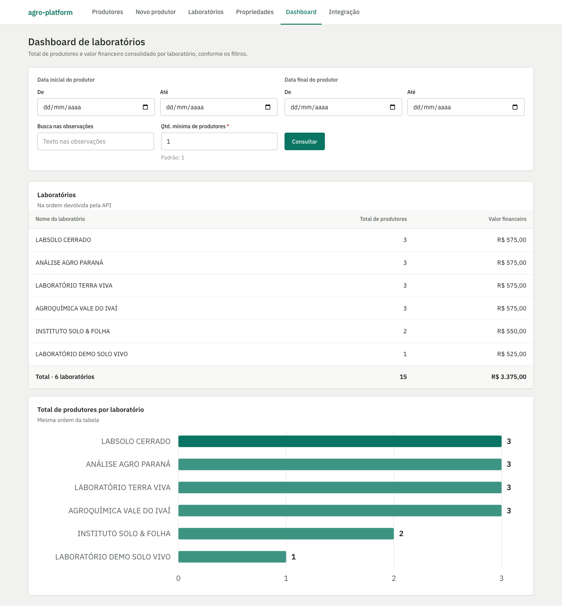

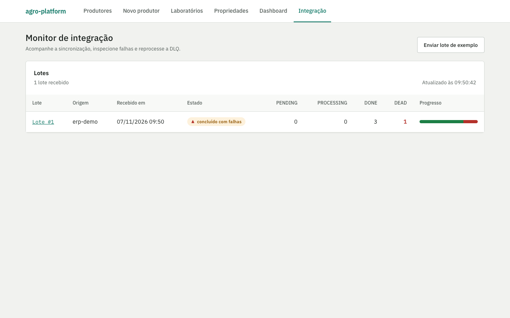

O lote de exemplo (`/integracao/enviar`) traz itens válidos e um produtor com CPF inválido: os válidos terminam `DONE` e o inválido vai para a DLQ, onde dá para ver o motivo e o payload e reprocessar.

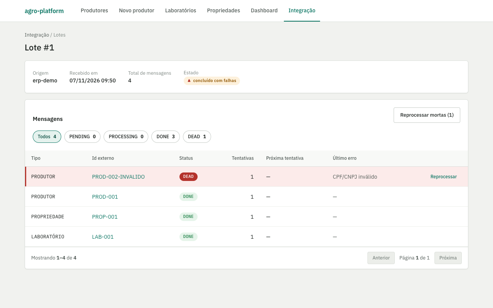

### De onde vêm laboratórios e propriedades

O formulário de produtor precisa de laboratório e de propriedades para escolher. Num banco vazio não há nenhum, e percebemos isso ao testar. Chegamos a considerar deixar esses cadastros só pela integração, mas **decidimos criar as telas** ([ADR-0017](docs/adr/0017-front-simples-com-vite-react-e-cliente-tipado.md)), para o formulário funcionar de ponta a ponta sem lote nem `curl`. Os dados também podem chegar pela integração (carga em volume, demonstração da DLQ).

- **Laboratórios** (`/laboratorios`): o CNPJ é obrigatório. Excluir um laboratório com produtores vinculados é recusado (409) e a tela mostra o motivo.
- **Propriedades** (`/propriedades`): CPF ou CNPJ; a lista mostra se a propriedade está disponível ou vinculada. Excluir uma propriedade vinculada a desvincula do produtor, que continua existindo (a confirmação avisa). O vínculo com o produtor é feito no formulário de produtor.
- Em banco vazio, o formulário de produtor avisa e leva ao cadastro correspondente.

Cada "Carregar exemplo" do monitor gera ids externos novos; reenviar o mesmo JSON sem alterar vira "duplicado" (a API é idempotente) e o lote fica vazio.

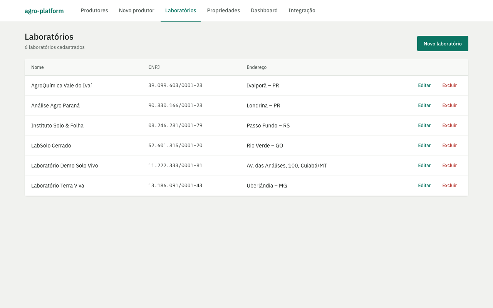

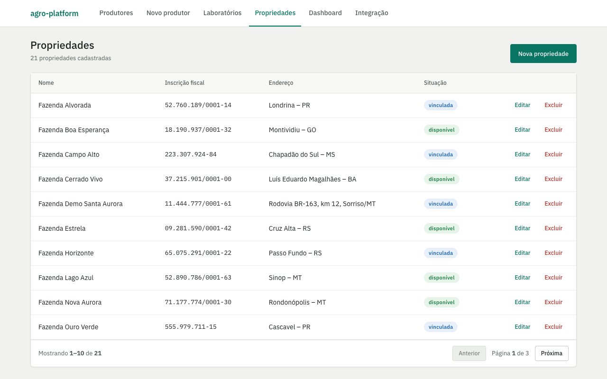

Os componentes ficam em `apps/web/src/components/` (tokens em `apps/web/src/styles/tokens.css`). Os testes (`pnpm --filter web test`) usam um `fetch` simulado e cobrem os cenários das specs; o `typecheck` do cliente quebra se a API mudar algo de que o web depende.

## Modelo de dados

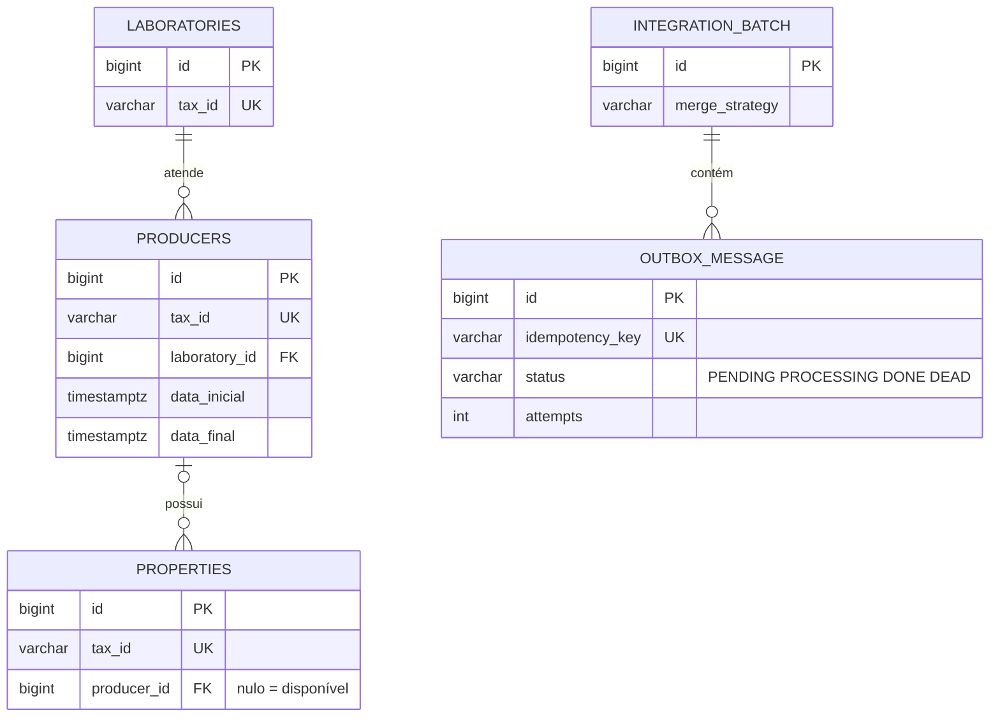

## Testes

`pnpm verify` roda tudo (veja [Verificação](#verificação)). Os testes `*Test` são unitários (sem Docker); os `*IT` usam Testcontainers. Os fluxos críticos têm cenários em Gherkin em [docs/bdd/](docs/bdd/README.md), cada um apontando para o teste que o verifica.

## Entrega: CI/CD e publicação

- **CI** ([ci.yml](.github/workflows/ci.yml)): em todo push para `main` e em todo pull request roda `pnpm docs:check` (links e índice de ADRs) e `pnpm verify`, publica os relatórios e resume os testes no sumário do job.
- **CD** ([deploy.yml](.github/workflows/deploy.yml)): em `main` com CI verde, publica as imagens no GHCR com a tag igual ao SHA e implanta na VPS por SSH com chave restrita ao comando `deploy <tag>`. Se os serviços não subirem ou a API não ficar saudável em 90 s depois de subir, a versão anterior é restaurada; reverter é o `workflow_dispatch` com a tag anterior ([ADR-0020](docs/adr/0020-pipeline-ci-cd-com-ghcr-e-ssh-restrito.md)).
- **Operação:** passo a passo em [docs/deploy.md](docs/deploy.md); os arquivos da VPS ficam em [infra/vps/](infra/vps/). `/actuator/info` mostra o SHA no ar.

## Premissas e limitações

- **Fórmulas financeiras:** o enunciado não as define; são premissas configuráveis ([ADR-0010](docs/adr/0010-motor-financeiro-como-strategy-puro-com-taxas-configuraveis.md)).
- **Total filtrado** da análise de laboratórios: premissa descrita em [Análise de laboratórios](#análise-de-laboratórios) ([ADR-0016](docs/adr/0016-consulta-analitica-em-sql-dinamico-como-leitura-separada.md)).
- **Atributos fiscais do produtor** (`dataInicial`, `dataFinal`, observações): assumidos a partir do enunciado.
- **CPF/CNPJ dos exemplos do enunciado são inválidos** nos dígitos verificadores; o sistema valida de verdade ([ADR-0009](docs/adr/0009-identificacao-fiscal-como-value-object.md)), então os testes e o seed usam inscrições válidas e fictícias.
- **Sem autenticação na aplicação** ([ADR-0019](docs/adr/0019-sem-autenticacao-nesta-entrega.md)): o demo público é protegido no proxy, só para escrita.
- **Fora de escopo:** alta disponibilidade, múltiplos ambientes e métricas com Prometheus/Grafana.

## Documentação e convenções

- Decisões: [docs/adr/](docs/adr/README.md). Commits: [docs/commits.md](docs/commits.md). Specs: [openspec/](openspec/).
- Decisões deliberadas de escopo: endereço em linha única de texto livre ([ADR-0018](docs/adr/0018-endereco-em-linha-unica.md)) e **sem autenticação** nesta entrega, com o plano para produção descrito ([ADR-0019](docs/adr/0019-sem-autenticacao-nesta-entrega.md)).
- Identificadores, rotas, tabelas e colunas em inglês; documentação, specs e textos da interface em português.
- O banco tem `COMMENT ON` em todas as tabelas e colunas ([`V1__schema.sql`](apps/api/src/main/resources/db/migration/V1__schema.sql) e [`V2__external_reference.sql`](apps/api/src/main/resources/db/migration/V2__external_reference.sql)).

## Uso de IA

Este projeto foi desenvolvido com assistência de IA (Claude Code) no fluxo spec-driven do OpenSpec: cada change nasce como proposta, specs, design e tarefas, e só então é implementado e arquivado. As specs e os ADRs guiaram o trabalho e delimitaram o que a IA podia fazer. O autor revisou e responde pelo código, pelos testes e pelas decisões. Os commits não levam coautoria de IA; o uso é declarado aqui ([ADR-0004](docs/adr/0004-commits-por-change-sem-coautoria-de-ia.md)).
