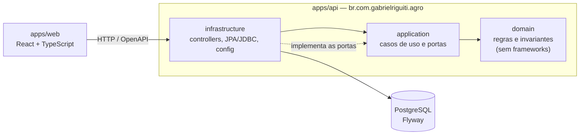

# agro-platform

Plataforma full-stack para gestão dos cadastros do ecossistema agrícola — **Produtor**, **Propriedade** e **Laboratório** — com integrador de dados resiliente, motor financeiro extensível e consulta analítica de laboratórios. Projeto de portfólio, desenvolvido change a change com [OpenSpec](openspec/) e decisões registradas em [ADRs](docs/adr/README.md).

> **Estado atual:** change `foundation` (base verificável): a API sobe, migra o banco, publica OpenAPI e logs em JSON, e o build falha se a arquitetura for violada. As regras de negócio chegam nos changes seguintes ([ordem dos changes](docs/ordem-dos-changes.md)).

## Stack

- **API:** Java 17, Spring Boot 3.3, Maven, PostgreSQL + Flyway, springdoc (OpenAPI 3), logs JSON, JUnit 5, Testcontainers e ArchUnit.
- **Web:** React + TypeScript (Vite), roteamento com React Router.
- **Monorepo:** pnpm + Turborepo ([ADR-0007](docs/adr/0007-monorepo-pnpm-turborepo-com-api-java.md)): `apps/api`, `apps/web` e `packages/api-client` (tipos gerados do OpenAPI).

## Como rodar

Pré-requisitos: JDK 17, Maven 3.9+, Node 20+, pnpm 10+ e Docker (PostgreSQL local e testes de integração).

```bash
pnpm install

# banco local (credenciais de desenvolvimento: agro/agro)
docker run -d --name agro-pg -e POSTGRES_USER=agro -e POSTGRES_PASSWORD=agro -e POSTGRES_DB=agro -p 5432:5432 postgres:16-alpine

# API em http://localhost:8080 (profile local = logs em texto)
cd apps/api && mvn spring-boot:run -Dspring-boot.run.profiles=local

# web em http://localhost:5173 (em outro terminal, a partir da raiz)
pnpm --filter @agro/api-client build   # gera os tipos do contrato
pnpm --filter web dev
```

Endereços da API: `/actuator/health`, `/v3/api-docs` e `/swagger-ui.html`. Configuração por variáveis de ambiente: `DB_URL`, `DB_USER`, `DB_PASSWORD`.

> Se a máquina tiver mais de um JDK, use o 17 (`JAVA_HOME`): o projeto compila com `release 17`.

## Verificação

```bash
pnpm verify      # API (testes unitários, ArchUnit e *IT com Testcontainers), web (typecheck, testes, build) e pacotes
pnpm docs:check  # links relativos da documentação
```

A API também funciona sem Node: `cd apps/api && mvn verify`. Testes `*Test` rodam no Surefire (sem Docker); testes `*IT` rodam no Failsafe e exigem Docker.

### Contrato OpenAPI e cliente do web

O contrato da API fica versionado em `packages/api-client/openapi.json`; `openapi-typescript` gera os tipos usados pelo web. Ao mudar a API, suba-a e rode `scripts/export-openapi.sh`: o `typecheck` do web quebra se ele usar algo que saiu do contrato.

## Arquitetura

Hexagonal com DDD pragmático ([ADR-0001](docs/adr/0001-arquitetura-hexagonal-com-ddd-pragmatico.md)), com fronteiras verificadas por ArchUnit no build ([ADR-0005](docs/adr/0005-fronteiras-de-arquitetura-verificadas-com-archunit.md)).



Regras (testadas em `ArchitectureTest`): `domain` só depende de Java padrão; `application` nunca depende de `infrastructure`; controllers não acessam a persistência; o motor financeiro não importa Spring.

## Documentação e convenções

- Decisões: [docs/adr/](docs/adr/README.md). Commits: [docs/commits.md](docs/commits.md). Specs: [openspec/](openspec/).
- Identificadores, rotas, tabelas e colunas em inglês; documentação, specs e textos da interface em português.
- O banco tem `COMMENT ON` em todas as tabelas e colunas ([`V1__schema.sql`](apps/api/src/main/resources/db/migration/V1__schema.sql)).

## Uso de IA

Este projeto foi desenvolvido com apoio de assistente de IA (Claude Code) para redigir specs, código, testes e documentação, sob direção e revisão do autor, que responde pelas decisões. Os commits não levam coautoria de IA; o uso é declarado aqui ([ADR-0004](docs/adr/0004-commits-por-change-sem-coautoria-de-ia.md)).
